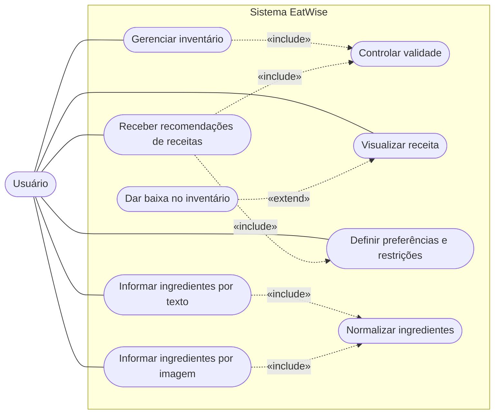
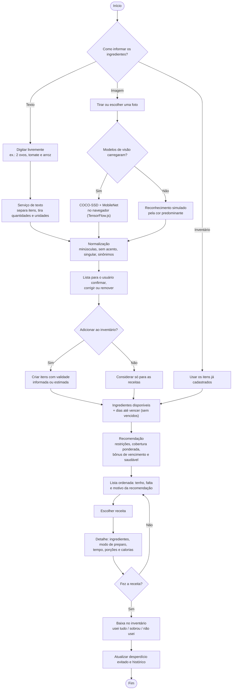
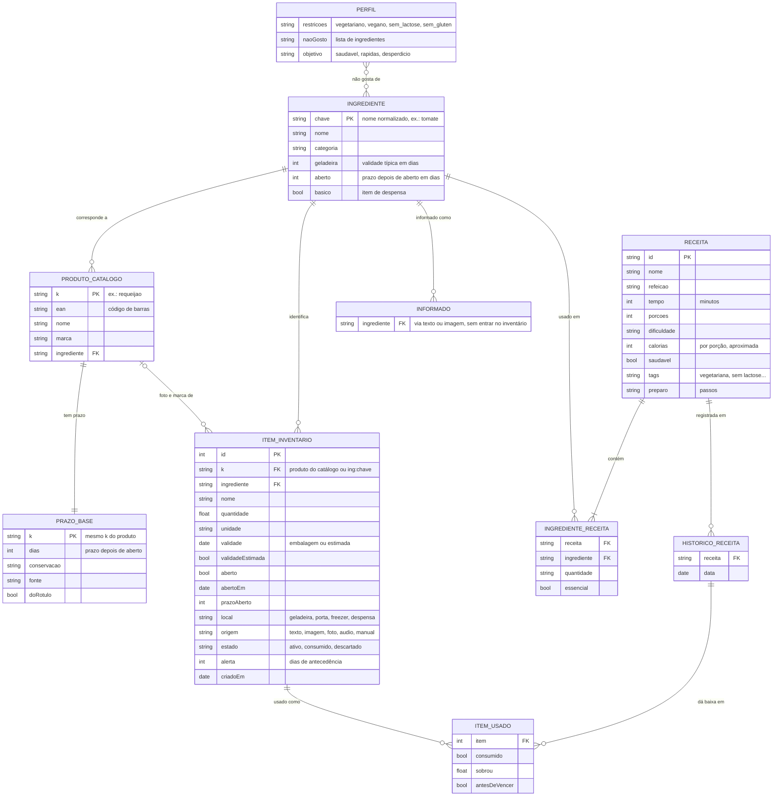

# EatWise · Diagramas

Diagramas em Mermaid do protótipo EatWise, para o artigo do TCC. O GitHub mostra os diagramas desenhados nesta página. As versões em imagem (SVG e PNG) estão na pasta `docs/img/`.

## 1. Diagrama de casos de uso

O Mermaid não tem um tipo próprio para casos de uso. Por isso o diagrama usa a notação de fluxograma: o ator fica à esquerda e cada caso de uso é uma elipse dentro do limite do sistema.

- **Gerenciar inventário**: cadastrar, editar, consumir, descartar e excluir itens.
- **Controlar validade**: calcular a data-limite (validade da embalagem ou abertura + prazo depois de aberto, a que vencer primeiro), o status e os alertas.
- **Informar ingredientes por texto ou por imagem**: as duas entradas passam pela normalização e por uma lista que o usuário confirma.
- **Receber recomendações**: usa o controle de validade (bônus para o que vence logo) e as preferências do perfil.
- **Dar baixa no inventário**: estende "Visualizar receita" pelo botão "Fiz esta receita".

## 2. Fluxograma do fluxo principal

Entrada de ingredientes → tratamento/reconhecimento → confirmação → recomendação → escolha da receita → baixa no inventário.

## 3. Diagrama do modelo de dados

Não há banco de dados: os dados ficam no navegador (`localStorage`, chaves `eatwise.v1.*`). A base de ingredientes, o catálogo de produtos, os prazos e as receitas são arquivos do próprio app.

